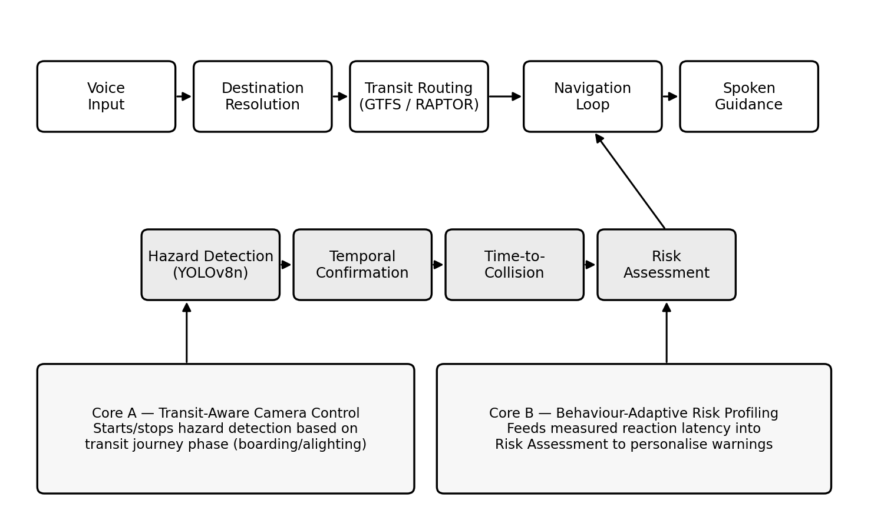
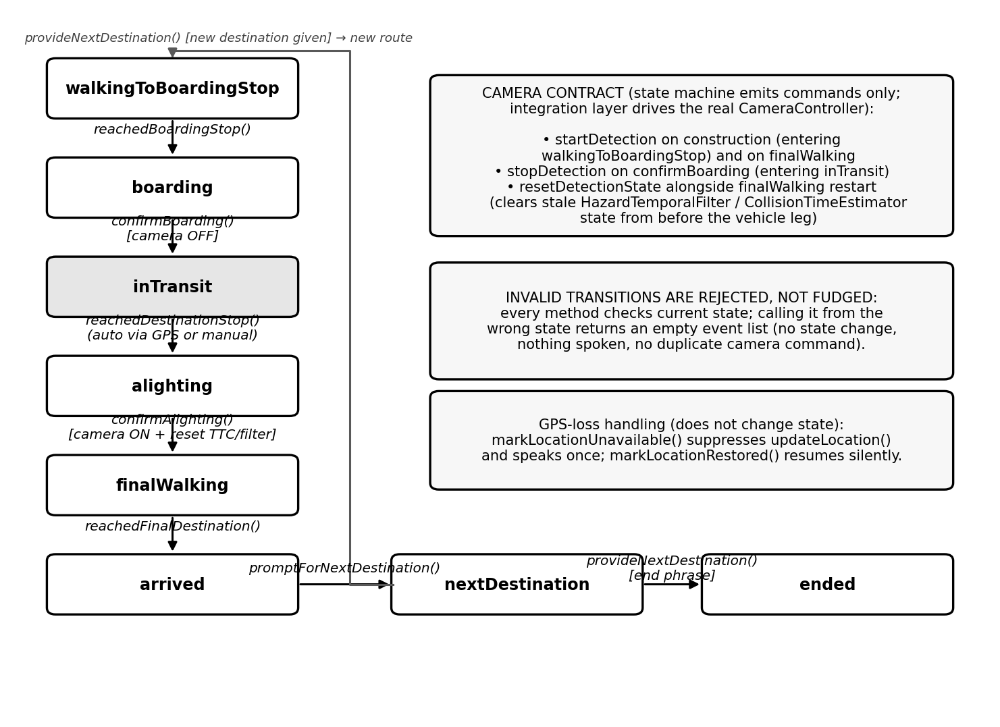
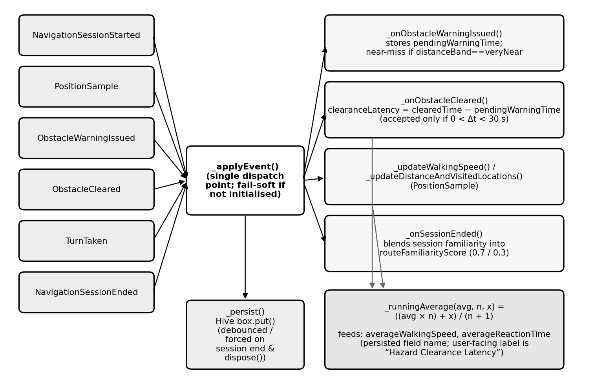

<div align="center">

# 🦯 INSIGHT

**Voice-first transit navigation for visually impaired pedestrians**


[**Live showcase**](https://insight-ai-brkydklrxs3glytquodkaq.streamlit.app/) · [**Download APK**](https://github.com/vaishnaviyog/INSIGHT-AI/releases/latest/download/app-release.apk) · [**Report an issue**](https://github.com/vaishnaviyog/INSIGHT-AI/issues)

</div>

---

INSIGHT is an Android app that helps a blind or low-vision person travel somewhere using public transit — entirely by voice. It resolves a spoken destination, plans a real multi-leg journey (walk → bus / metro / suburban rail → walk), and guides the rider step by step, while an on-device camera watches for obstacles along the way.

## Contents

- [The two ideas that make this different](#the-two-ideas-that-make-this-different)
- [What it does](#what-it-does)
- [How a journey works](#how-a-journey-works)
- [Architecture](#architecture)
- [Screenshots](#screenshots)
- [Project structure](#project-structure)
- [Building](#building)
- [Testing](#testing)
- [Tech stack](#tech-stack)

## The two ideas that make this different

**Core A — Transit-Aware Camera Control.** The hazard-detection camera doesn't run the whole time. A journey-state machine tracks where the rider actually is — walking to the stop, boarding, riding, alighting, walking to the destination — and automatically switches the camera **off** while the rider is seated inside a vehicle, since there's no pedestrian hazard to detect indoors, and back **on** the moment they get off.

**Core B — Behaviour-Adaptive Risk Profiling.** The app quietly measures, for every hazard warning it actually speaks, how long it takes for that hazard to clear from view. Over time this builds a per-user profile — walking speed, warning responsiveness, route familiarity — that personalises how urgently future warnings are delivered, instead of one fixed setting for every rider.

No reviewed assistive-navigation system combines both of these in one implementation — see [`showcase/app.py`](showcase/app.py) or the live demo above for the fuller picture.

## What it does

- **Voice-first navigation** — destination capture, journey selection, and turn-by-turn guidance all by voice, with typed/tapped fallback if speech input isn't available.
- **Real transit routing** — a RAPTOR-based journey planner over a merged GTFS feed (bus, metro, and suburban rail), with real street-level walking directions for the first/last mile.
- **On-device hazard detection** — a YOLOv8n object detector, temporal confirmation, and a time-to-collision estimate feed a transparent, explainable risk-scoring engine.
- **Emergency SOS** — manual trigger and automatic fall detection, both routing to the same cancellable countdown and SMS/call flow.

## How a journey works

1. **Speak a destination** — cleaned up, matched against known places, with an honest-confidence geocoding fallback if nothing matches.
2. **Plan the journey** — RAPTOR searches the real, merged GTFS feed for the best multi-leg route; walking legs get real street-level directions.
3. **Navigate** — camera, GPS, compass, and voice guidance run together; an on-device detector and a transparent risk score decide what gets spoken and how urgently.
4. **Board and ride** — Core A pauses the camera on boarding and resumes it, with a clean reset, on alighting.
5. **Arrive** — the app asks where to go next, or ends the session cleanly.

## Architecture

**Overall system** — the main navigation pipeline and the hazard-detection pipeline, with Core A and Core B's integration points annotated.



**Core A — transit-session state machine** — the full 8-state diagram as implemented, including the camera start/stop contract and GPS-loss handling.



**Core B — behaviour-learning pipeline** — the event-driven update flow from six real event types through to the persisted per-user profile.



All three diagrams are generated directly from the real source (`docs/diagrams/make_figure*.py`), not drawn freehand — they describe the code as it actually behaves.

## Screenshots

_Real on-device screenshots coming soon — drop image files into `docs/screenshots/` and they'll show up here._

## Project structure

| Path | Contents |
|---|---|
| `lib/services/transit/` | Journey-state machine driving camera on/off behaviour (Core A) |
| `lib/services/behaviour_learning_service.dart` | Per-user behaviour/reaction profile (Core B) |
| `lib/services/journey/`, `lib/services/gtfs/` | Transit routing (RAPTOR) and GTFS data handling |
| `lib/services/hazard_detectors/`, `lib/services/hazard_detection_service.dart` | On-device object detection pipeline |
| `lib/services/risk_assessment_service.dart`, `lib/services/adaptive_risk/` | Hazard risk scoring and warning prioritisation |
| `lib/services/voice_understanding/` | Spoken destination resolution |
| `lib/onboarding/` | Voice-driven onboarding flow |
| `lib/ui/` | App screens |
| `test/unit/` | 476-test automated suite |
| `showcase/` | Streamlit project showcase page |

## Building

Two optional features read their API keys at build time rather than from source:

```bash
flutter build apk --release \
  --dart-define=GEMINI_API_KEY=your_gemini_key \
  --dart-define=ORS_API_KEY=your_openrouteservice_key
```

- `GEMINI_API_KEY` — enables the on-demand scene-description feature (Google Gemini).
- `ORS_API_KEY` — enables real street-level walking directions (OpenRouteService). Without it, walking routes fall back to an OSRM public demo endpoint automatically.

Both are optional — the app builds and runs normally without either, with the corresponding feature degrading gracefully.

## Testing

```bash
flutter test      # 476 tests
flutter analyze   # static analysis
```

The suite includes unit tests, fixed-seed property/stress tests, GPS-noise simulations, and a network-wide routing audit that runs 400 randomised real stop-to-stop pairs against the full production GTFS feed — see `test/unit/chennai_network_wide_routing_audit_test.dart`.

## Tech stack

`Flutter / Dart` · `TensorFlow Lite (YOLOv8n)` · `SQLite (GTFS)` · `Hive` · `RAPTOR routing` · `OpenRouteService` · `Google Gemini`

## Academic context

Developed as an SOP (student project) at **VIT Chennai**, School of Advanced Sciences.

- **Authors**: Vaishnavi Y, Rinad R
- **Guided by**: Dr. Harshavardhini Shanmugam, Dr. Pavithra R
