<div align="center">

# 🦯📡 INSIGHT — Hardware Extension

**A fault-tolerant ultrasonic + haptic wearable, simulated end-to-end as a companion to the INSIGHT app**


[**Main INSIGHT app**](../) · [**Novelty / patentability notes**](docs/NOVELTY_CONTRIBUTION.md) · [**Full review report**](docs/REVIEW_REPORT_2026-10-22.md)

</div>

---

This folder is **Dissertation 1**: a separate, external hardware layer explored as a companion to the main [INSIGHT](../) Flutter app. Where INSIGHT uses the phone's camera for hazard detection, this prototype explores a second, independent channel — three ultrasonic sensors and directional vibration — that keeps working by touch even when a phone can't be looked at or heard. It does not touch or modify the INSIGHT app's code in any way.

**Everything here is simulated.** The circuit is built and driven by real firmware in the [Wokwi](https://wokwi.com) simulator, not sketched on paper, and every result below comes from an executed, automated test run — not a manual trace. But no physical hardware has been purchased or built. That distinction is kept explicit throughout this README and its linked docs, not buried in a limitations section at the bottom.

## Contents

- [Safety scope — read this first](#safety-scope--read-this-first)
- [What this project is](#what-this-project-is)
- [Architecture](#architecture)
- [The core idea: fault-tolerant sensing](#the-core-idea-fault-tolerant-sensing)
- [Screenshots — live simulation](#screenshots--live-simulation)
- [Components](#components)
- [Haptic feedback pattern](#haptic-feedback-pattern)
- [Test evidence](#test-evidence)
- [Is this patentable?](#is-this-patentable)
- [Limitations](#limitations)
- [Running the simulation](#running-the-simulation)
- [Project structure](#project-structure)
- [Next steps](#next-steps)

## Safety scope — read this first

**This device, even once physically built exactly as specified here, is a supplement to a white cane, guide dog, or mobility training — never a replacement for one.**

**Not detected by this device, at all:**
- Stairs, curbs, potholes, drop-offs, open manholes — the three sensors face outward from the chest, not downward. This is arguably the single most important gap: ground-level hazards are among the most common serious injury risks for a blind pedestrian, and this device gives zero warning for any of them.
- Overhead obstacles below head height but above the chest-mounted sensors.
- Anything outside the three sensors' combined forward/left/right field of view — there is no rear coverage.

**Can be unreliable even for what it does face:**
- Glass, mirrors, and smooth angled surfaces can reflect the ultrasonic pulse away from the sensor, reading identically to "no obstacle."
- No real-world testing exists yet for outdoor weather/wind, acoustic cross-talk between the three sensors, or haptic-pattern distinguishability on real skin — see [`docs/SIMULATION_LIMITATIONS.md`](docs/SIMULATION_LIMITATIONS.md).

**The SOS button does not call or message anyone.** In this prototype it only logs an event to the Serial console. No phone app, emergency contact, or dispatch integration exists yet.

## What this project is

A low-cost wearable prototype — one ESP32 microcontroller, three HC-SR04 ultrasonic sensors (front, left, right), two haptic outputs, a buzzer, and an emergency button — fully designed and simulated in Wokwi, driven by real firmware.

A review of seven closely-related 2025–2026 low-cost assistive-wearable systems found a consistent, citable gap: none of them detect or compensate for one of their own sensors failing. That gap is what this prototype was built to close, and every claim about it is backed by an automated, executed test, not a manual trace.

## Architecture

**System pipeline** — sensing through to actuation, running on a fixed 300ms cycle.

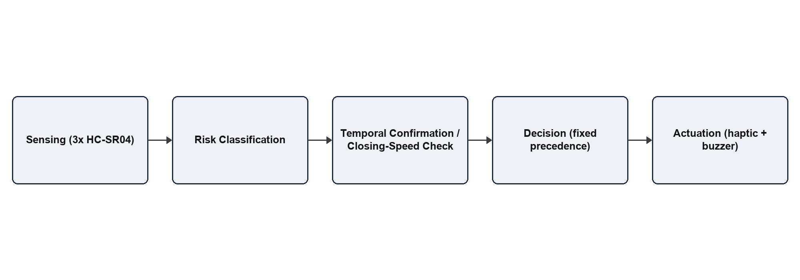

**Wiring** — the ESP32 and its seven peripherals, including the voltage dividers each HC-SR04's 5V echo line needs before reaching the ESP32's 3.3V-only GPIO.

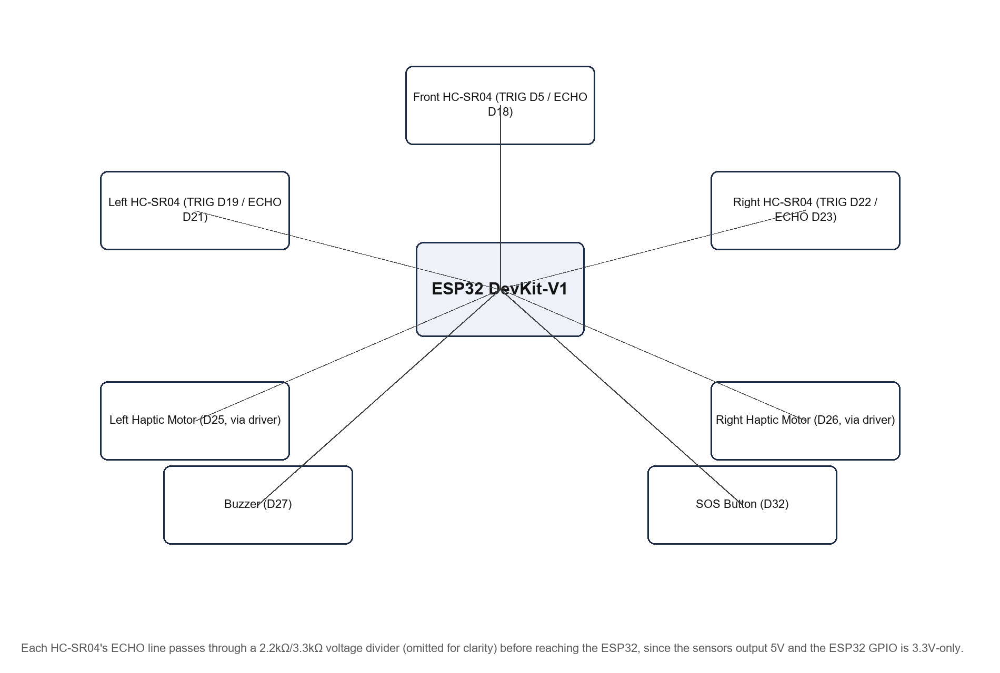

**Decision logic** — the fixed-precedence chain that turns three sensor readings into one of six haptic states. Deliberately not a machine-learning model: for a safety device, every output should be traceable to exactly one rule, not inferred from a black box.

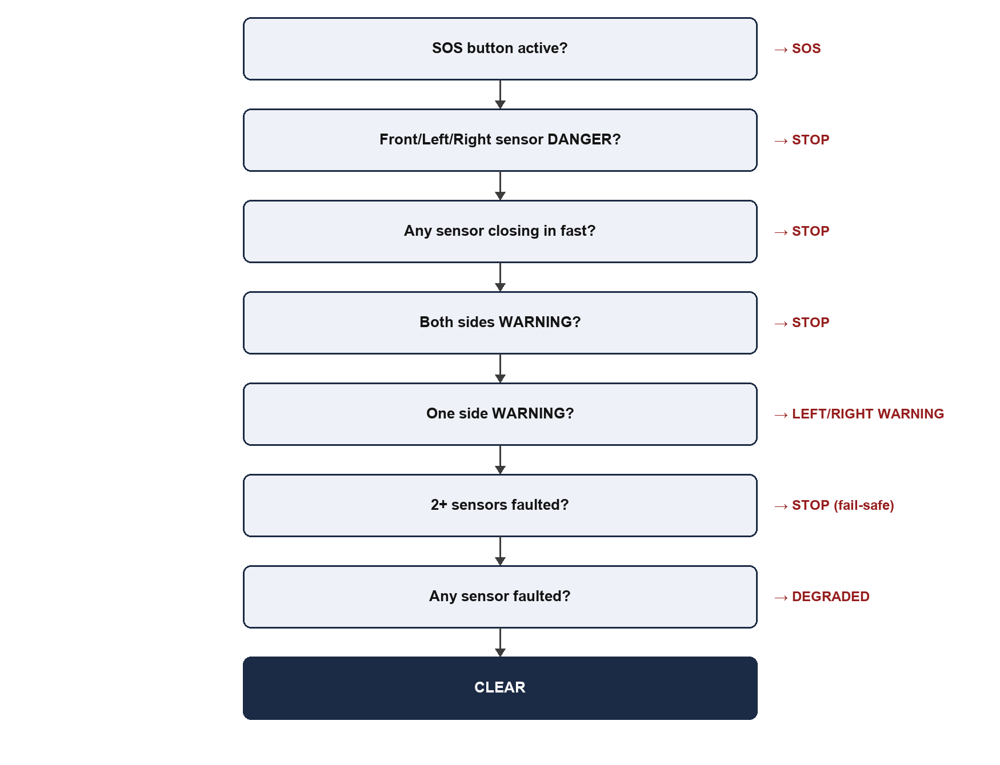

## The core idea: fault-tolerant sensing

Most low-cost obstacle-detection wearables assume their sensors always work. This one assumes they won't, eventually, and is built to say so honestly instead of quietly reporting "all clear."

**Adaptive Fault-Tolerant Zone Reallocation** — when one sensor stops responding, its geometric neighbour's warning threshold automatically widens (50cm → 75cm) to partially cover the resulting blind spot. The danger threshold is never widened, so this can only trigger an earlier heads-up, never fabricate a false emergency stop. A dedicated `DEGRADED` haptic state tells the user explicitly that coverage is reduced, instead of a silent `CLEAR` that looks identical to full protection.

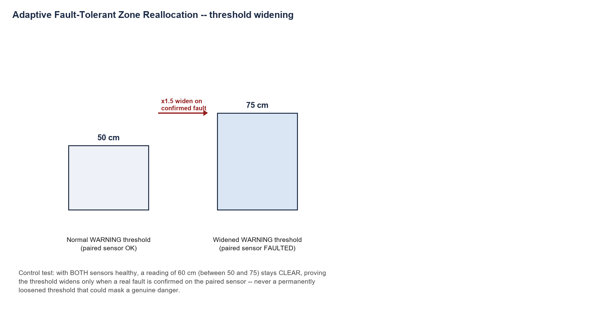

Three further robustness mechanisms were added and proven alongside it:

| Mechanism | What it does |
|---|---|
| **Correlated multi-fault fail-safe** | If two or three sensors fail at once, a single widened threshold can't responsibly cover for it — compensation is disabled entirely and the device falls back to its most conservative output, unless a genuine reading from a remaining healthy sensor says otherwise. |
| **Temporal confirmation filter** | A WARNING-level reading must persist for two consecutive cycles before it's acted on, so a single noisy blip doesn't cause a false alert. DANGER readings and faults are never delayed by this. |
| **Closing-speed escalation** | If a reading drops sharply between two cycles, the device escalates straight to its most conservative output, ahead of and independent of the normal fixed thresholds — catching a fast-approaching obstacle a slower-reacting fixed-threshold system might miss. |

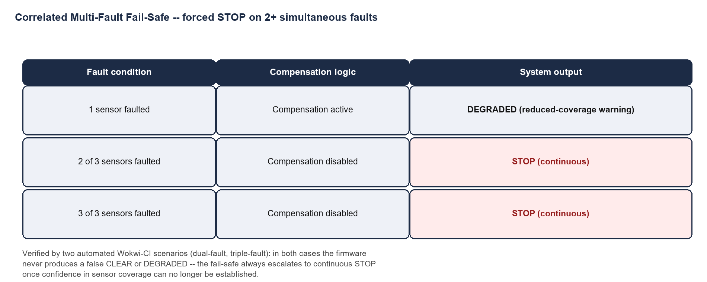
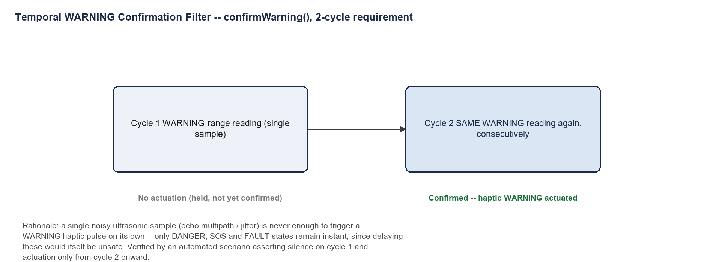
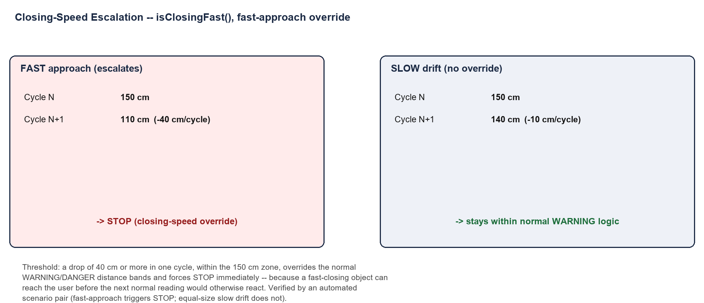

## Screenshots — live simulation

Real simulated sensor values and real firmware Serial decision-log lines, captured directly from the Wokwi simulation — not staged.

| | |
|---|---|
| 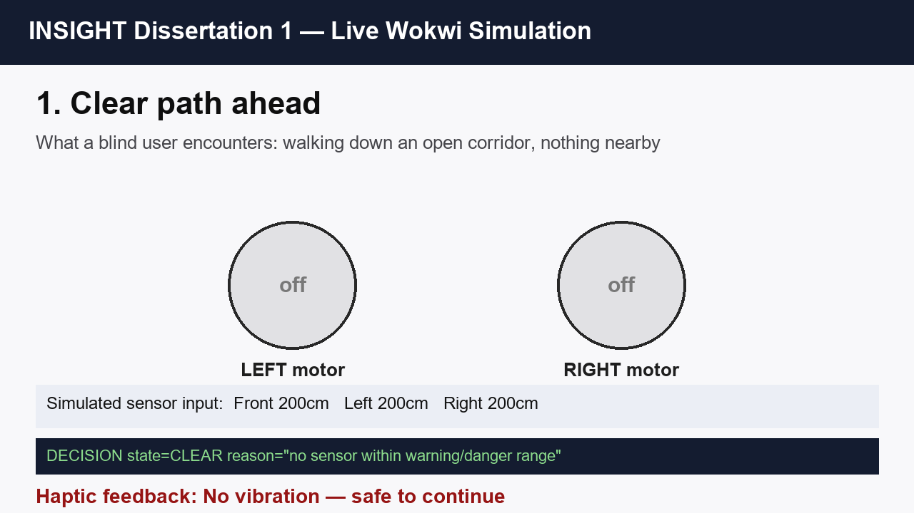 | 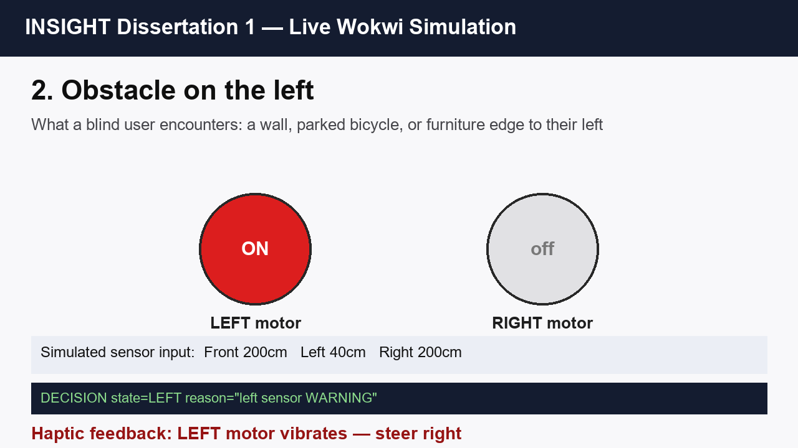 |
| 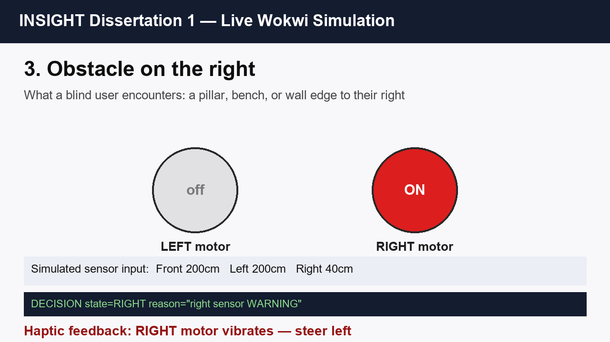 | 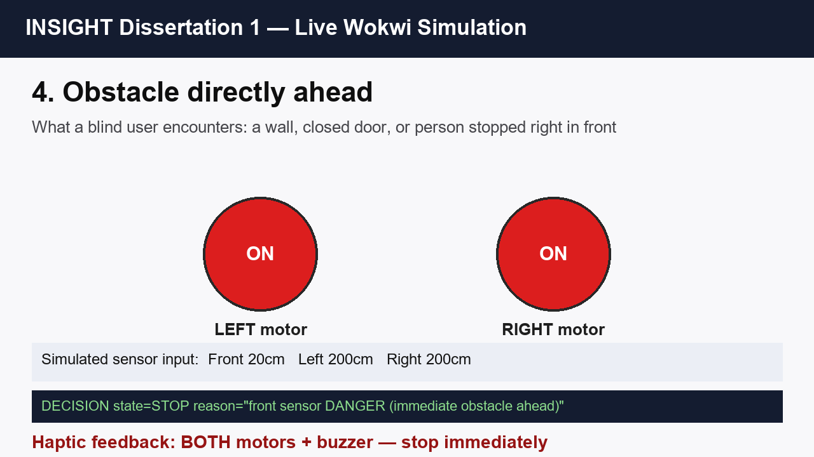 |
| 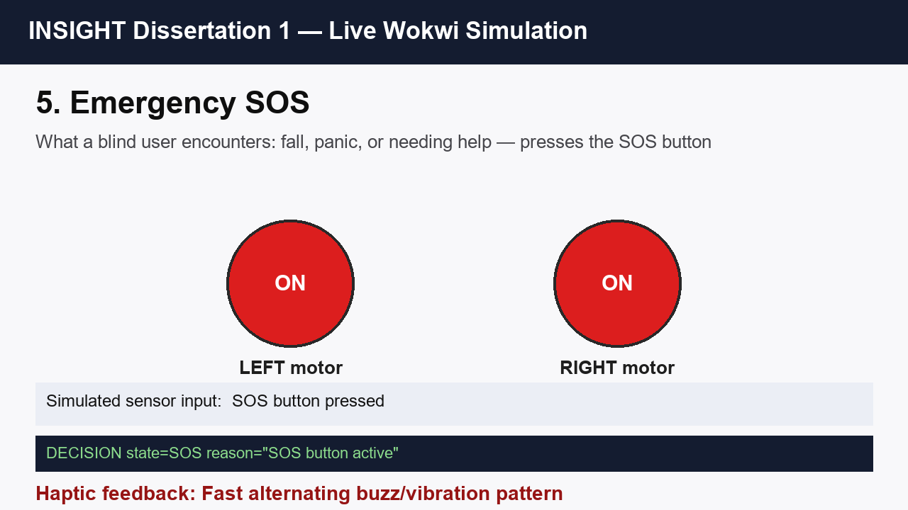 | |

A full video walkthrough assembled from these same captures is in [`video_frames/INSIGHT_demo.mp4`](video_frames/INSIGHT_demo.mp4); how it was built (honestly, from real capture, not stock footage) is documented in [`video_frames/README.md`](video_frames/README.md).

## Components

- 1× ESP32 DevKit-V1 (central controller)
- 3× HC-SR04 ultrasonic sensors (front / left / right)
- 6× resistors (2.2kΩ/3.3kΩ ×3 pairs) forming a voltage divider on each sensor's ECHO line — required because the sensors output 5V and the ESP32's GPIO is 3.3V-only
- 2× vibration-motor haptic outputs (LEDs stand in for these in Wokwi, which has no motor part — the real MOSFET driver stage is designed, not simulated, in [`docs/CIRCUIT_CONNECTIONS.md`](docs/CIRCUIT_CONNECTIONS.md))
- 1× piezo buzzer (STOP/SOS audible cue)
- 1× SOS pushbutton, debounced

Full wiring detail: [`docs/CIRCUIT_CONNECTIONS.md`](docs/CIRCUIT_CONNECTIONS.md). Power-path design and the critical voltage-divider fix: [`docs/POWER_ARCHITECTURE.md`](docs/POWER_ARCHITECTURE.md).

## Haptic feedback pattern

| State | Left motor | Right motor | Buzzer | Meaning |
|---|---|---|---|---|
| CLEAR | Off | Off | Off | Safe to continue |
| LEFT_WARNING | Pulsing | Off | Off | Obstacle approaching on the left |
| RIGHT_WARNING | Off | Pulsing | Off | Obstacle approaching on the right |
| STOP | Continuous | Continuous | On | Immediate danger — stop now |
| SOS | Fast alternating | Fast alternating | Fast alternating | Emergency signal active |
| DEGRADED | Slow pulse | Slow pulse | Off | Compensation active, coverage reduced |

## Test evidence

Every mechanism above is backed by an automated test run against the live simulated circuit via `wokwi-cli` — not a manual trace.

| Scenario file | Assertions | Result |
|---|---|---|
| `test_scenario.yaml` (main pipeline) | 22 | PASS |
| `test_scenario_fault.yaml` (single fault) | 2 | PASS |
| `test_scenario_fault_degraded.yaml` (DEGRADED state) | 2 | PASS |
| `test_scenario_dual_fault.yaml` (2-of-3 fault) | 6 | PASS |
| `test_scenario_triple_fault.yaml` (3-of-3 fault) | 4 | PASS |
| `test_scenario_confirm_filter.yaml` (temporal filter) | 4 | PASS |
| `test_scenario_closing_speed.yaml` (closing speed) | 4 | PASS |
| **Total — 7 scenario files** | **44** | **44/44 PASS** |

Full writeup and what this does/doesn't prove: [`docs/REVIEW_REPORT_2026-10-22.md`](docs/REVIEW_REPORT_2026-10-22.md). Full test matrix, including which rows are executed vs. still predicted: [`docs/DISSERTATION1_TEST_PLAN.md`](docs/DISSERTATION1_TEST_PLAN.md). The original manual trace (useful for understanding *why*, not as evidence on its own): [`tests/SCENARIO_TRACE.md`](tests/SCENARIO_TRACE.md).

## Is this patentable?

Honestly: the general idea of a neighbouring sensor compensating for a failed one is **not** novel in isolation — directly comparable techniques exist in fault-tolerant sensing literature since at least 1991, and in automotive ultrasonic parking-sensor patents. What's reviewed here as potentially defensible is narrower: the specific combination of adaptive neighbour-threshold widening, correlated multi-fault fail-safe, temporal confirmation, and closing-speed escalation, applied together on a single low-cost wearable platform for this particular visually-impaired-navigation use case — at a stage the closely-reviewed recent literature had not reached. That's a translation of known techniques into an underserved niche, not an invention of fault-tolerant sensing itself. Full reasoning: [`docs/NOVELTY_CONTRIBUTION.md`](docs/NOVELTY_CONTRIBUTION.md).

## Limitations

- No physical hardware has been built, so no real sensor accuracy, acoustic cross-talk, real haptic-motor perceptibility, or battery/power behaviour has been measured — every threshold and timing constant here is a reasoned simulation placeholder, not an empirically calibrated value.
- Wokwi's HC-SR04 model is an ideal sensor: no multipath, no temperature-dependent speed-of-sound drift, no cross-talk between the three sensors firing in sequence.
- No wireless link exists yet — this is a single wired ESP32 with three co-located sensors, correctly described as embedded/IoT sensing, not a wireless sensor network. See [`docs/WSN_STAGE2_DESIGN.md`](docs/WSN_STAGE2_DESIGN.md) for the smallest change that would make a WSN label true.

Full, unabridged list: [`docs/SIMULATION_LIMITATIONS.md`](docs/SIMULATION_LIMITATIONS.md).

## Running the simulation

**Interactive (VS Code extension or wokwi.com):**
1. Install the **Wokwi Simulator** extension in VS Code, or use wokwi.com directly.
2. Open the `wokwi/` folder itself as the workspace root (it contains `diagram.json`, `wokwi.toml`, `main.ino`, `wokwi_types.h`).
3. Start the simulation (`Ctrl+Shift+P` → "Wokwi: Start Simulator").
4. Drag each HC-SR04's distance slider to set up a scenario; press the pushbutton to trigger SOS.

**Automated (`wokwi-cli`, no GUI):**
```bash
cd wokwi
export WOKWI_CLI_TOKEN="<your token from wokwi.com/dashboard/ci>"
wokwi-cli . --scenario test_scenario.yaml --timeout 30000
```
Requires `arduino-cli` with the ESP32 core installed to compile `main.ino` first (the VS Code extension does this automatically).

## Project structure

| Path | Contents |
|---|---|
| `wokwi/main.ino` | Firmware — sensing, decision pipeline, fault-tolerance mechanisms |
| `wokwi/diagram*.json` | Circuit variants (main, single-fault, dual-fault, triple-fault) |
| `wokwi/test_scenario*.yaml` | 7 automated test scenario scripts (44 assertions total) |
| `docs/` | Architecture analysis, novelty/patentability notes, circuit and power design, limitations, review report |
| `docs/diagrams/` | Architecture and mechanism-proof diagrams shown above |
| `docs/screenshots/` | Real simulation captures shown above |
| `video_frames/` | Demo video and the real captures it was built from |
| `tests/SCENARIO_TRACE.md` | Manual code trace (predates the automated suite) |

## Next steps

1. Purchase the essential components only (see [Components](#components)) — a physical Stage 1 build on a breadboard, matching this simulation.
2. Re-run the test plan for real, filling in observed/pass-fail against actual hardware.
3. Only after that works: add the one genuinely wireless node described in [`docs/WSN_STAGE2_DESIGN.md`](docs/WSN_STAGE2_DESIGN.md) — the smallest change that earns a real WSN label.
4. Only after that works: move to the wearable form factor in [`docs/PHYSICAL_PLACEMENT.md`](docs/PHYSICAL_PLACEMENT.md), with a real fitting/comfort/safety review.
5. A genuine usability study with visually-impaired participants, even a small one — nothing in this simulation substitutes for that.

## Academic context

Developed as Dissertation 1 at **VIT Chennai**, School of Advanced Sciences.

- **Authors**: Vaishnavi Y, Rinad R
- **Guided by**: Dr. Pavithra R
